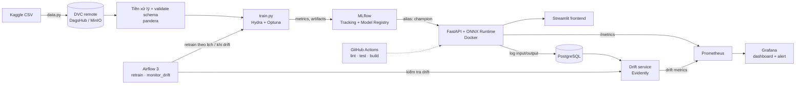

# Hotel Booking Cancellation — MLOps Pipeline

> Dự án môn **IT5414 – Vận hành hệ thống học máy** · Nhóm `07`
> Dự báo khả năng một đặt phòng khách sạn bị hủy, được xây dựng và vận hành như một hệ thống học máy hoàn chỉnh: dữ liệu → huấn luyện → triển khai → giám sát.

---

## 1. Mục tiêu tổng thể

Khách sạn mất doanh thu đáng kể khi khách hủy phòng sát ngày hoặc không đến (no-show). Nếu biết trước xác suất một đặt phòng bị hủy ngay tại thời điểm khách đặt, bộ phận quản lý doanh thu có thể điều chỉnh chính sách đặt cọc, overbooking hoặc chủ động liên hệ khách.

Dự án xây dựng một **hệ thống dự báo hủy phòng** (bài toán phân loại nhị phân, nhãn `is_canceled`), với trọng tâm là **vận hành hệ thống** thay vì tối ưu độ chính xác mô hình.

Dự án được coi là thành công khi đạt được:

- **Tái lập (reproducible):** dữ liệu và mô hình được tái tạo trên bất kỳ máy nào bằng vài lệnh (`dvc pull` → `train`), cho cùng một kết quả.
- **Tự động hóa:** mọi thay đổi đi qua Pull Request; CI tự chạy lint, unit test, đo coverage và build Docker image.
- **Triển khai:** mô hình được phục vụ qua REST API (FastAPI) đóng gói Docker, khởi chạy toàn bộ bằng `docker compose` trên máy local.
- **Giám sát:** hệ thống thu thập input/output của API, phát hiện được data drift khi "phát lại" dữ liệu của giai đoạn sau, và expose được các system metrics lên dashboard Grafana kèm cảnh báo.
- **Huấn luyện liên tục:** Airflow tự retrain mô hình theo chu kỳ và khi phát hiện drift; mô hình mới chỉ được đưa vào phục vụ khi tốt hơn mô hình đang chạy.

## 2. Framework và cách tích hợp

**Framework bên thứ ba chính: [scikit-learn](https://scikit-learn.org/).** Mô hình dự báo là một estimator tương thích scikit-learn; mô hình cụ thể chưa được chốt. Cách tích hợp vào dự án:

1. **Một pipeline duy nhất cho train và serve:** `ColumnTransformer` (impute, one-hot, scale) và estimator được gói chung trong một `sklearn.Pipeline`. API nhận dữ liệu thô và dùng đúng pipeline đã train, tránh lệch tiền xử lý giữa lúc huấn luyện và lúc phục vụ (training–serving skew).
2. **Cấu hình bằng Hydra:** loại mô hình, siêu tham số, cách chia dữ liệu và đường dẫn đều nằm trong `configs/`, không hard-code trong mã nguồn. Đổi mô hình chỉ cần đổi config.
3. **Theo dõi thí nghiệm:** mỗi lần train ghi metrics, config và artifact mô hình lên MLflow. Tối ưu siêu tham số bằng Optuna, mỗi trial được log thành một nested run. Mô hình được đăng ký vào MLflow Model Registry: alias `champion` là mô hình đang phục vụ, `challenger` là mô hình mới chờ so sánh.
4. **Tối ưu suy luận:** pipeline được export sang ONNX (`skl2onnx`, kèm `onnxmltools` với các mô hình gradient boosting) và chạy bằng ONNX Runtime trong API. Độ trễ và kích thước artifact của bản `joblib` và bản ONNX được so sánh với nhau.
5. **Huấn luyện lại tự động:** Airflow gọi lại chính pipeline và cấu hình Hydra ở trên để retrain theo chu kỳ hoặc khi phát hiện drift (chi tiết ở mục 6).

**Các công cụ MLOps khác:**

| Khía cạnh | Công cụ |
|---|---|
| Quản lý môi trường & dependency | `uv`, `pyproject.toml`, `uv.lock` |
| Cấu trúc dự án | cookiecutter |
| Chất lượng mã | `ruff` (lint + format), type hints + `mypy`, `pre-commit` |
| Phiên bản dữ liệu | DVC (remote: DagsHub khi phát triển, MinIO khi chạy bằng docker compose) |
| Kiểm tra dữ liệu | pandera |
| Cấu hình | Hydra |
| Logging | `loguru` |
| Theo dõi thí nghiệm & Model Registry | MLflow |
| Tối ưu siêu tham số | Optuna |
| Orchestration | Apache Airflow 3 |
| Kiểm thử | `pytest`, `pytest-cov`, Locust (load test) |
| CI/CD | GitHub Actions, CML |
| Đóng gói & phục vụ | Docker, docker compose, FastAPI, ONNX Runtime |
| Frontend | Streamlit |
| Lưu trữ | PostgreSQL, MinIO |
| Giám sát | Evidently (data drift), `prometheus-client`, Prometheus, Grafana |
| Tài liệu | MkDocs |

## 3. Dữ liệu

**[Hotel booking demand](https://www.kaggle.com/datasets/jessemostipak/hotel-booking-demand)** (Kaggle; nguồn gốc: Antonio, Almeida & Nunes, *Data in Brief*, 2019).

- 119.390 lượt đặt phòng, 32 cột, từ hai khách sạn ở Bồ Đào Nha (*City Hotel* và *Resort Hotel*).
- Ngày đến (arrival date) trải từ 07/2015 đến 08/2017.
- Nhãn `is_canceled`: khoảng 37% đặt phòng bị hủy.
- Dung lượng nhỏ (dưới 20 MB), phù hợp để chạy toàn bộ pipeline trên máy cá nhân.

**Xử lý rò rỉ nhãn (data leakage):** loại bỏ `reservation_status` và `reservation_status_date` vì hai cột này mã hóa trực tiếp kết quả hủy. Các cột có thể thay đổi sau thời điểm đặt (`assigned_room_type`, `booking_changes`, `days_in_waiting_list`) sẽ được đánh giá lại để phù hợp với kịch bản "dự báo tại thời điểm đặt phòng".

**Chia dữ liệu theo thời gian để mô phỏng production:**

- *Reference / train–validation:* các đặt phòng có ngày đến từ 07/2015 đến 12/2016.
- *Production stream:* 01/2017 đến 08/2017, được "phát lại" theo từng tháng vào API để kiểm tra drift. Nhãn của mỗi tháng chỉ được mở sau khi tháng đó phát lại xong (mô phỏng độ trễ của nhãn) và được dùng để retrain.
- *Kịch bản drift bổ sung:* train trên một khách sạn và suy luận trên khách sạn còn lại để kiểm tra độ bền của mô hình.

Dữ liệu thô và dữ liệu đã xử lý được quản lý phiên bản bằng DVC. Schema dữ liệu sau xử lý được kiểm tra trong unit test.

## 4. Mô hình

| Vai trò | Mô hình | Ghi chú |
|---|---|---|
| Baseline | Logistic Regression | Mốc so sánh, dùng chung pipeline tiền xử lý |
| Mô hình chính | TBD | Estimator tương thích scikit-learn, chọn theo kết quả đánh giá |
| Thử nghiệm (tùy chọn) | PyTorch Tabular | So sánh với mô hình chính trên MLflow |

**Chỉ số đánh giá:**

- *Mô hình:* ROC-AUC, PR-AUC, F1.
- *Vận hành:* độ trễ suy luận (p50/p95), throughput dưới tải, kích thước artifact.

## 5. Môi trường làm việc

Toàn bộ hệ thống chạy local bằng Docker Desktop và `docker compose`, không triển khai lên cloud.

- **Phát triển:** Python 3.12 + `uv` (phiên bản khóa trong `uv.lock`); `pre-commit` chạy `ruff` trước mỗi commit; `pytest` chạy local và trên GitHub Actions.
- **Dịch vụ dùng chung:** DagsHub cung cấp MLflow tracking server (kèm Model Registry) và DVC remote.
- **Triển khai local:** các service dưới đây được tự host bằng `docker compose`, không phụ thuộc Internet.

| Service | Công nghệ | Vai trò |
|---|---|---|
| `api` | FastAPI + ONNX Runtime | Dự đoán, `/metrics`, nạp mô hình `champion` |
| `frontend` | Streamlit | Giao diện nhập booking / upload CSV |
| `mlflow` | MLflow | Tracking, Model Registry |
| `minio` | MinIO | Artifact store, DVC remote (S3) |
| `postgres` | PostgreSQL | Metadata Airflow/MLflow, log dự đoán |
| `airflow-*` | Apache Airflow 3 | DAG `retrain`, `monitor_drift` |
| `drift` | FastAPI + Evidently | Tính drift, xuất metrics drift |
| `prometheus` | Prometheus | Thu thập metrics |
| `grafana` | Grafana | Dashboard, cảnh báo |

**Cài đặt môi trường phát triển** (yêu cầu [uv](https://docs.astral.sh/uv/getting-started/installation/) và Git):

```bash
git clone https://github.com/quandao073/IT5414-Group7-MLOps.git
cd IT5414-Group7-MLOps
git switch develop
uv sync                     # tạo .venv với Python 3.12 theo uv.lock
uv run pre-commit install   # cài git hook (ruff, kiểm tra file)
uv run invoke test          # chạy test kèm coverage
```

Quy trình nhánh, Pull Request và quy ước commit: xem [CONTRIBUTING.md](CONTRIBUTING.md).

## 6. Kiến trúc dự kiến



**Vòng huấn luyện lại:** DAG `retrain` được kích hoạt theo lịch (chu kỳ cấu hình được) hoặc bởi DAG `monitor_drift` khi tỉ lệ cột bị drift vượt ngưỡng. Mỗi lần chạy: lấy dữ liệu đã có nhãn → kiểm tra schema → huấn luyện → đăng ký mô hình với alias `challenger` → so sánh với `champion` trên tháng có nhãn gần nhất → promote nếu tốt hơn → API nạp lại `champion`.

## 7. Cấu trúc thư mục

```text
├── .github/workflows/        # CI: lint, test, build image
├── airflow/dags/             # DAG retrain, monitor_drift
├── configs/                  # Hydra config
│   ├── data/
│   ├── hpo/                  # không gian tìm kiếm Optuna
│   ├── model/                # mỗi loại mô hình một file config
│   └── train/
├── data/                     # quản lý bằng DVC: raw/, processed/, stream/ (8 batch 2017)
├── dockerfiles/              # Dockerfile cho từng service
├── docs/                     # tài liệu MkDocs
├── models/                   # artifact mô hình local (joblib, ONNX)
├── monitoring/
│   ├── grafana/              # dashboards/, provisioning/
│   └── prometheus/           # cấu hình scrape
├── notebooks/                # EDA, thử nghiệm
├── reports/figures/          # hình cho báo cáo
├── src/hotel_booking/        # mã nguồn: dữ liệu, huấn luyện, API, drift
├── tests/                    # unit test; performance/ chứa Locust
├── docker-compose.yml        # toàn bộ service chạy local
├── pyproject.toml, uv.lock   # dependency (uv)
└── tasks.py                  # lệnh invoke
```

## 8. Thành viên

| Thành viên | MSSV | Phụ trách chính |
|---|---|---|
| Đào Anh Quân (trưởng nhóm) | 20251237E | TBD |
| Lê Vũ Hoàng Tùng | 20251239E | TBD |
| Nguyễn Đắc Quang | 20260121E | TBD |
| Phạm Nhật Anh | 20250729E | TBD |
