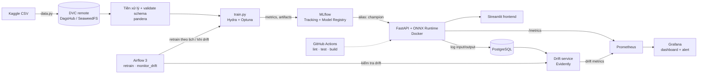

# Hotel Booking MLOps — Nhóm 07

> Dự án môn **IT5414 – Vận hành hệ thống học máy** · Nhóm `07`

Khách sạn mất doanh thu khi khách hủy phòng sát ngày hoặc không đến. Hệ thống này dự báo
**xác suất một đặt phòng bị hủy** ngay tại thời điểm khách đặt, để bộ phận quản lý doanh thu
điều chỉnh chính sách cọc, overbooking hoặc chủ động liên hệ khách.

Đây là bài toán phân loại nhị phân với nhãn `is_canceled`, được xây dựng và vận hành như một
hệ thống học máy hoàn chỉnh: **dữ liệu → huấn luyện → triển khai → giám sát → huấn luyện lại**.

## Kiến trúc

## Công cụ chính

| Khía cạnh | Công cụ |
|---|---|
| Môi trường & dependency | `uv`, `pyproject.toml`, `uv.lock` |
| Chất lượng mã | `ruff`, `mypy`, `pre-commit` |
| Phiên bản dữ liệu | DVC (DagsHub khi phát triển, SeaweedFS khi chạy compose) |
| Kiểm tra dữ liệu | pandera |
| Cấu hình | Hydra |
| Theo dõi thí nghiệm & registry | MLflow |
| Tối ưu siêu tham số | Optuna |
| Orchestration | Apache Airflow 3 |
| Đóng gói & phục vụ | Docker, FastAPI, ONNX Runtime, Streamlit |
| Giám sát | Evidently, Prometheus, Grafana |
| CI/CD | GitHub Actions, CML |

## Bắt đầu đọc

- [Bắt đầu](getting-started.md) — cài môi trường, lấy dữ liệu, chạy train và serve.
- [Cấu hình](configuration.md) — Hydra, biến môi trường, DagsHub/MLflow/DVC.
- [API](api.md) — endpoint, schema và ví dụ gọi.
- [Vận hành](operations.md) — pipeline dữ liệu, drift, Airflow, Prometheus/Grafana.
- [Hợp đồng](contracts.md) — quy ước giữa các module.

## Trạng thái

Tài liệu được build bằng MkDocs và tự động deploy lên GitHub Pages khi `main` thay đổi
(task **1.8.2**). Mã nguồn và báo cáo chi tiết nằm trong
[repository GitHub](https://github.com/quandao073/IT5414-Group7-MLOps).
