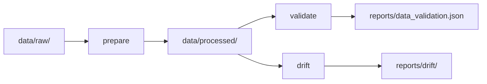

# Vận hành

Trang này mô tả cách hệ thống chạy sau khi triển khai: dữ liệu đi qua pipeline nào, drift được
phát hiện ra sao, khi nào huấn luyện lại và theo dõi bằng metric gì.

## Pipeline dữ liệu

DVC chia pipeline thành ba stage độc lập, khai báo trong `dvc.yaml`:



| Stage | Lệnh | Output | Thất bại khi |
|---|---|---|---|
| `prepare` | `uv run invoke preprocess-data` | `data/processed/train.csv`, `test.csv` | Dữ liệu thô thiếu cột hoặc rỗng |
| `validate` | `uv run invoke validate-data` | `reports/data_validation.json` | Schema pandera không khớp |
| `drift` | `uv run invoke drift-report` | `reports/drift/` | Không đủ dòng để so sánh |

Chạy toàn bộ: `uv run dvc repro`. DVC chỉ chạy lại stage có input thay đổi.

Báo cáo đã công bố:

- [Profiling dữ liệu](https://github.com/quandao073/IT5414-Group7-MLOps/blob/develop/reports/profiling.md)
- [Drift offline](https://github.com/quandao073/IT5414-Group7-MLOps/blob/develop/reports/drift.md)
- [Độ bền mô hình](https://github.com/quandao073/IT5414-Group7-MLOps/blob/develop/reports/durability.md)

## Replay và nhãn trễ

Nhãn `is_canceled` chỉ biết sau ngày nhận phòng, nên log dự đoán được đối chiếu theo tháng:

```bash
uv run invoke replay --months 2017-01,2017-02 --delay 0.5
```

Replay gửi từng tháng tới `POST /predict/batch` kèm header `X-Replay-Month: YYYY-MM`. API ghi
input, `probability`, `is_canceled` và `threshold` vào bảng `prediction_logs`. Sau khi gửi hết
một tháng, replay mới mở nhãn: ghi `labels/<month>.csv` và, nếu có `DATABASE_URL`, ghi vào
bảng `labels`. Cột `replay_month` là khóa để drift service và báo cáo tách dữ liệu theo tháng.

## Drift

### Offline

`invoke drift-report` so sánh `train.csv` với từng tháng của tập test và giữa hai khách sạn
(`Resort Hotel` và `City Hotel`), sinh report HTML trong `reports/drift/html/` và bảng tỉ lệ
cột bị drift trong `reports/drift/summary.csv`. Các cột lịch bị loại khỏi so sánh vì luôn khác
giữa hai giai đoạn. Nhận xét tổng hợp nằm ở
[reports/drift.md](https://github.com/quandao073/IT5414-Group7-MLOps/blob/develop/reports/drift.md).

### Online

Drift service (`src/hotel_booking/drift_service.py`, cổng `8001`) đọc `prediction_logs` và so
với dữ liệu tham chiếu bằng Evidently. Service chạy độc lập, **chưa nằm trong `docker compose`**:

```bash
uv run invoke serve-drift
```

| Endpoint | Ý nghĩa |
|---|---|
| `GET /health` | `status`, `reference_rows`, có `DATABASE_URL` hay không |
| `GET /drift?month=YYYY-MM` | Drift của một tháng replay |
| `GET /drift?start=...&end=...` | Drift theo `created_at` trong `[start, end)`, ISO 8601 |
| `GET /drift/latest` | Tháng replay mới nhất; DAG `monitor_drift` gọi endpoint này |
| `GET /drift/report?...` | Report HTML của Evidently, cùng tham số với `/drift` |
| `GET /metrics` | Metric Prometheus |

Response gồm `window`, `rows`, `reference_rows`, `columns`, `drifted_columns`, `drift_share`
(0–1), `dataset_drift` (`drift_share >= 0.5`) và `details` từng cột (`column`, `method`,
`threshold`, `score`, `drifted`).

Cửa sổ ít hơn `DRIFT_MIN_ROWS` dòng trả `404`; thiếu `DATABASE_URL` thì các endpoint `/drift*`
trả `503`; truyền đồng thời `month` với `start`/`end` trả `422`.

## Airflow

Airflow 3 chạy trong docker compose, giao diện tại `http://localhost:8080`.

| DAG | Lịch | Việc làm |
|---|---|---|
| `stack_health` | định kỳ | Kiểm tra các service còn sống |
| `monitor_drift` | mặc định `*/10 * * * *` (`MONITOR_DRIFT_SCHEDULE`) | Gọi `/drift/latest`; nếu `drift_share` vượt `drift_share_threshold` (mặc định 0.5) và là tháng mới thì trigger DAG `retrain` |

`monitor_drift` ghi tháng vừa trigger vào Variable `monitor_drift_last_window`, nên mỗi tháng
chỉ gây huấn luyện lại tối đa một lần. DAG chỉ điều phối qua HTTP; phép tính drift nằm trong
drift service.

!!! note "DAG `retrain`"
    Repo hiện có `airflow/dags/monitor_drift.py` và `airflow/dags/stack_health.py`.
    `monitor_drift` trigger DAG id `retrain`; nếu DAG đó chưa có trong `airflow/dags/` thì
    trigger không chạy. Khi cần huấn luyện lại ngay, dùng `uv run invoke retrain` bên dưới.

## Huấn luyện lại và promote

```bash
uv run invoke retrain --overrides "promotion.min_delta=0.002"
```

`retrain` huấn luyện challenger, so `roc_auc` với champion hiện tại trên MLflow Registry và chỉ
promote khi challenger tốt hơn ít nhất `min_delta`. Sau khi promote, gọi `/reload` để API dùng
phiên bản mới:

```bash
curl -X POST http://localhost:8000/reload -H "X-Reload-Token: $RELOAD_TOKEN"
```

Nếu `/reload` thất bại, API trả `503` và **tiếp tục phục vụ mô hình cũ** — không có thời gian
chết. Kiểm tra phiên bản đang chạy bằng `GET /health` hoặc metric `api_model_info`.

Các lệnh registry:

```bash
uv run invoke registry --command "show"
uv run invoke registry --command "promote --version 3"
uv run invoke registry --command "demote --version 3"
```

## Giám sát

API và drift service expose `/metrics`; Prometheus và Grafana **chưa được nối vào
`docker compose`** — `monitoring/prometheus/` và `monitoring/grafana/` hiện chỉ có file giữ chỗ.
Khi dựng, trỏ Prometheus vào `api:8000/metrics` và `drift:8001/metrics` (hoặc
`localhost` khi chạy ngoài compose) rồi import dashboard từ `monitoring/grafana/dashboards/`.

| Thành phần | Địa chỉ khi tự dựng | Vai trò |
|---|---|---|
| Prometheus | `http://localhost:9090` | Thu metric từ API và drift service |
| Grafana | `http://localhost:3000` | Dashboard và cảnh báo |
| MLflow | `http://localhost:5000` | Run, artifact, model registry |
| Airflow | `http://localhost:8080` | Lịch và trạng thái DAG |

Cảnh báo quan trọng nên đặt trên Grafana:

- `api_requests_total` với `status=5xx` tăng — API đang lỗi.
- `api_request_latency_seconds` p95 vượt ngưỡng — suy giảm độ trễ.
- `drift_share` vượt 0.5 — dữ liệu đầu vào lệch khỏi train.
- `api_input_warnings_total` tăng theo `column` — xuất hiện category mới.
- `api_model_reloads_total{result="failure"}` tăng — promote không tới được API.

## Docker compose

```bash
docker compose up -d --build
docker compose ps
docker compose logs -f api
docker compose down
```

| Service | Cổng | Ghi chú |
|---|---|---|
| `api` | 8000 | FastAPI + ONNX Runtime tùy `MODEL_BACKEND` |
| `frontend` | 8501 | Streamlit, gọi `API_URL` |
| `mlflow` | 5000 | Artifact trên SeaweedFS |
| `postgres` | 5432 | Log dự đoán, metadata Airflow/MLflow |
| `seaweedfs` | 8333 | S3-compatible cho artifact và DVC remote `local` |
| `airflow-apiserver`, `airflow-scheduler`, `airflow-dag-processor` | 8080 | Airflow 3, LocalExecutor |

`drift`, Prometheus và Grafana không có trong compose hiện tại; drift service chạy bằng
`uv run invoke serve-drift` như mục [Drift](#drift).

Biến môi trường và giá trị mặc định xem [Cấu hình](configuration.md#bien-moi-truong) và
[Hợp đồng](contracts.md#c11-docker-compose).

## Việc cần làm khi vận hành

1. Theo dõi `stack_health` và dashboard Grafana mỗi ngày.
2. Khi `monitor_drift` trigger `retrain`, xem run mới trên MLflow trước khi promote.
3. Sau promote, gọi `/reload` và xác nhận `current_version` qua `GET /health`.
4. Sao lưu `prediction_logs` và artifact MLflow trước khi thay đổi hạ tầng.
