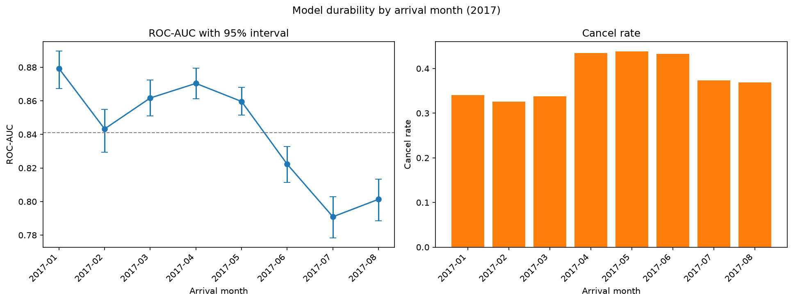
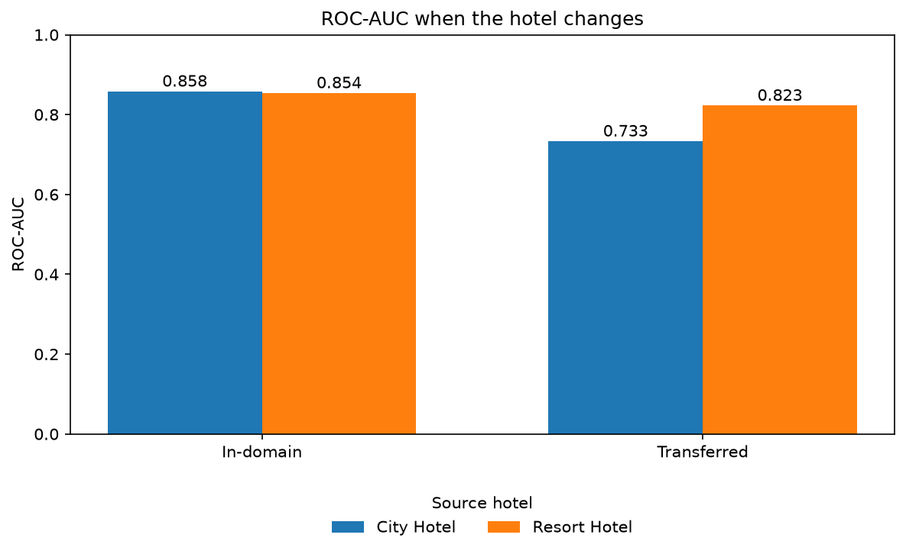

# Độ bền của mô hình: ROC-AUC theo tháng và khi đổi khách sạn (task 1.6.5)

Sinh bằng `uv run invoke durability-report` từ `data/processed` với `configs/model/champion.yaml`. Số liệu ở
`reports/durability/metrics.csv` và `reports/durability/summary.json`; hình ở
`reports/figures/durability_roc_by_month.png` và `reports/figures/durability_hotel_transfer.png`.

## Cách đo

- **Mô hình:** soft-voting ensemble của champion (Random Forest + XGBoost + LightGBM) trong
  `configs/model/champion.yaml`, huấn luyện mới trên toàn bộ tập train (07/2015–12/2016, 78.586 dòng). Không dùng
  artifact `models/model.joblib` vì file này không được commit.
- **Theo tháng:** fit một lần trên train, chấm từng tháng đến của 2017 (01–04 thuộc `test`, 05–08 thuộc
  `production_holdout`) — đúng các batch mà replay phát vào API. ROC-AUC và average precision (AP) tính trên xác
  suất huỷ; khoảng tin cậy 95% lấy bằng bootstrap phân vị, 500 lần lấy mẫu lại, seed 42.
- **Đổi khách sạn:** với mỗi cặp nguồn → đích trong {City Hotel, Resort Hotel}, fit trên `train` của khách sạn
  nguồn rồi chấm `test` của khách sạn đích. Ô trên đường chéo là in-domain (fit và chấm cùng khách sạn); ô ngoài
  đường chéo là transfer. `transfer_gap` = ROC-AUC in-domain của khách sạn nguồn − ROC-AUC transfer.

## Kết quả theo tháng

| Tháng | Dòng | Tỉ lệ huỷ | ROC-AUC | KTC 95% | AP |
|---|---:|---:|---:|---:|---:|
| 2017-01 | 3.673 | 0,340 | 0,879 | 0,867–0,890 | 0,828 |
| 2017-02 | 4.168 | 0,326 | 0,843 | 0,829–0,855 | 0,768 |
| 2017-03 | 4.948 | 0,338 | 0,862 | 0,851–0,872 | 0,813 |
| 2017-04 | 5.653 | 0,435 | 0,870 | 0,861–0,879 | 0,860 |
| 2017-05 | 6.305 | 0,438 | 0,860 | 0,851–0,868 | 0,855 |
| 2017-06 | 5.639 | 0,432 | 0,822 | 0,811–0,833 | 0,819 |
| 2017-07 | 5.310 | 0,374 | 0,791 | 0,778–0,803 | 0,704 |
| 2017-08 | 4.923 | 0,368 | 0,801 | 0,788–0,813 | 0,703 |

## Kết quả khi đổi khách sạn

| Nguồn → Đích | Dòng | Tỉ lệ huỷ | ROC-AUC | AP | Khoảng cách |
|---|---:|---:|---:|---:|---:|
| City → City | 12.255 | 0,425 | 0,858 | 0,852 | 0,000 |
| City → Resort | 6.187 | 0,246 | 0,733 | 0,528 | 0,125 |
| Resort → City | 12.255 | 0,425 | 0,823 | 0,820 | 0,031 |
| Resort → Resort | 6.187 | 0,246 | 0,854 | 0,717 | 0,000 |

## Nhận xét

- **Mô hình vẫn xếp hạng tốt qua cả 8 tháng**, ROC-AUC từ 0,791 đến 0,879 và mọi khoảng tin cậy đều nằm trên 0,77.
  Mức giảm mạnh nhất là từ 0,879 (01/2017) xuống 0,791 (07/2017), tức 0,088; tháng 8 hồi lại nhẹ (0,801).
- **Tháng 7–8 là điểm yếu,** trùng với các tháng drift mạnh nhất trong `reports/drift.md` (16–17/22 cột). AP giảm
  rõ hơn ROC-AUC (0,704 và 0,703 so với 0,828 hồi tháng 1), nghĩa là ngoài việc xếp hạng kém hơn, mô hình còn khó
  tách nhóm huỷ khi tỉ lệ huỷ thấp hơn (0,37 so với 0,43 hồi tháng 4–5). Đây là mùa hè: `adr`, `lead_time`, số đêm
  và loại phòng/đặt cọc khác rõ so với train.
- **Đổi khách sạn tốn kém hơn drift theo tháng.** City → Resort mất 0,125 ROC-AUC (0,858 → 0,733) và AP rơi từ
  0,852 xuống 0,528, trong khi Resort → City chỉ mất 0,031. Mô hình học trên City phụ thuộc nhiều vào tệp khách và
  cách đặt phòng đặc trưng của City; sang Resort, các tín hiệu đó đổi nghĩa. Chiều ngược lại dễ hơn vì City đa dạng
  hơn và tập train của Resort nhỏ hơn, nên mô hình Resort ít bám vào đặc thù riêng.
- **Hệ quả cho giám sát:** drift theo tháng chưa làm hỏng mô hình, nhưng thay đổi cơ cấu khách sạn/property có thể.
  Nếu hệ thống nhận một khách sạn mới hoặc tỉ lệ City/Resort đổi mạnh, nên chấm lại theo từng khách sạn và cân nhắc
  fit bổ sung dữ liệu của khách sạn đích thay vì chỉ dựa vào ngưỡng drift chung. Ngưỡng retrain hiện tại
  (`drift_share_threshold`, mặc định 0,5) sẽ không bắt được kịch bản này vì `hotel` gần như không drift.
