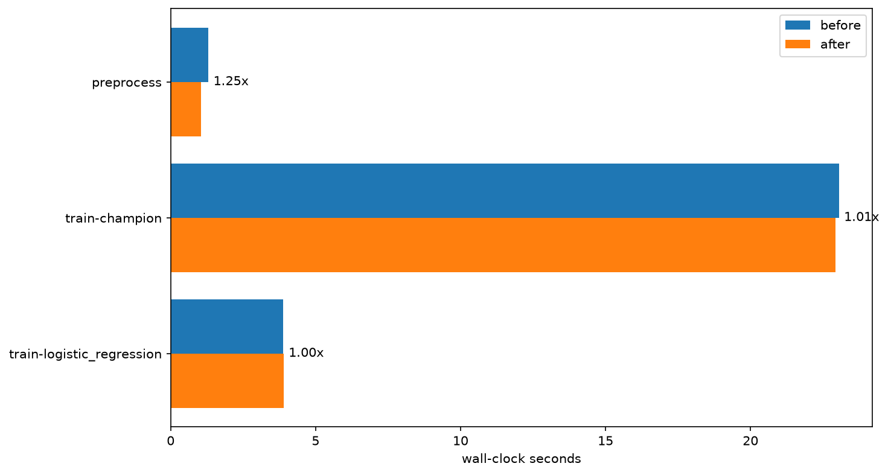
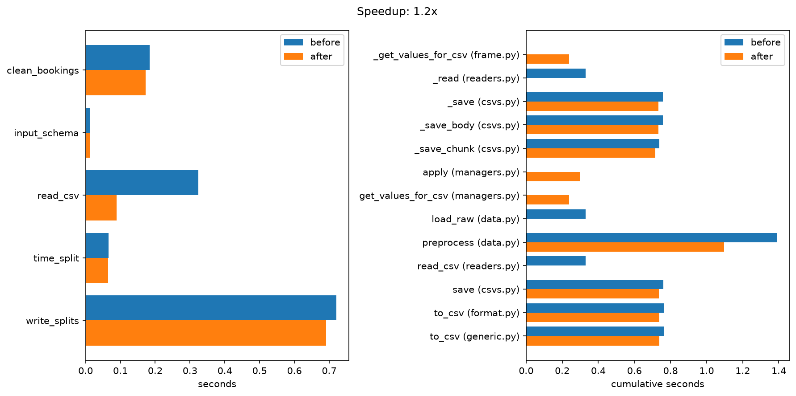
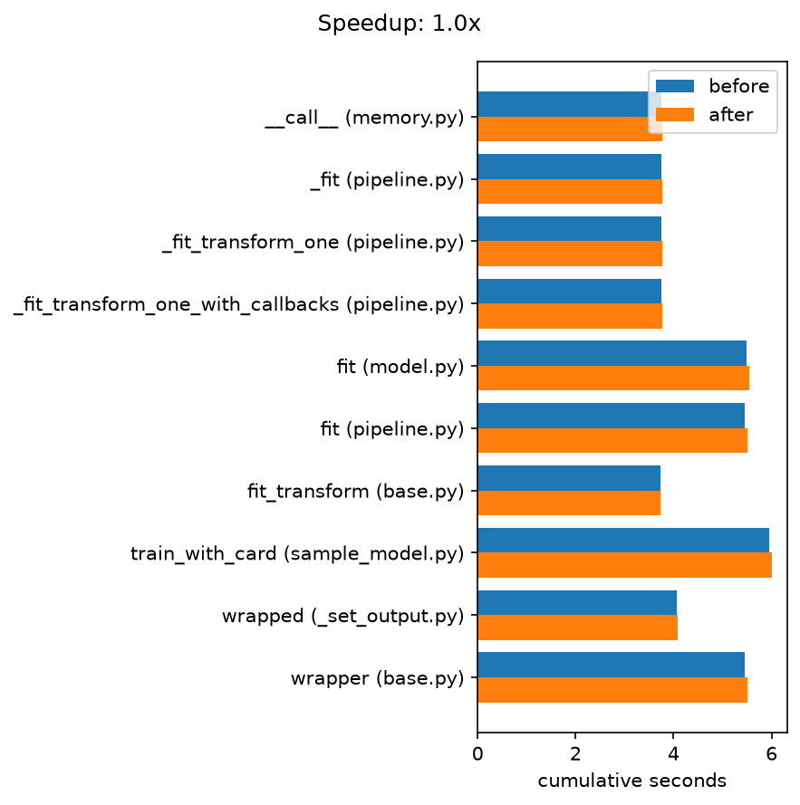
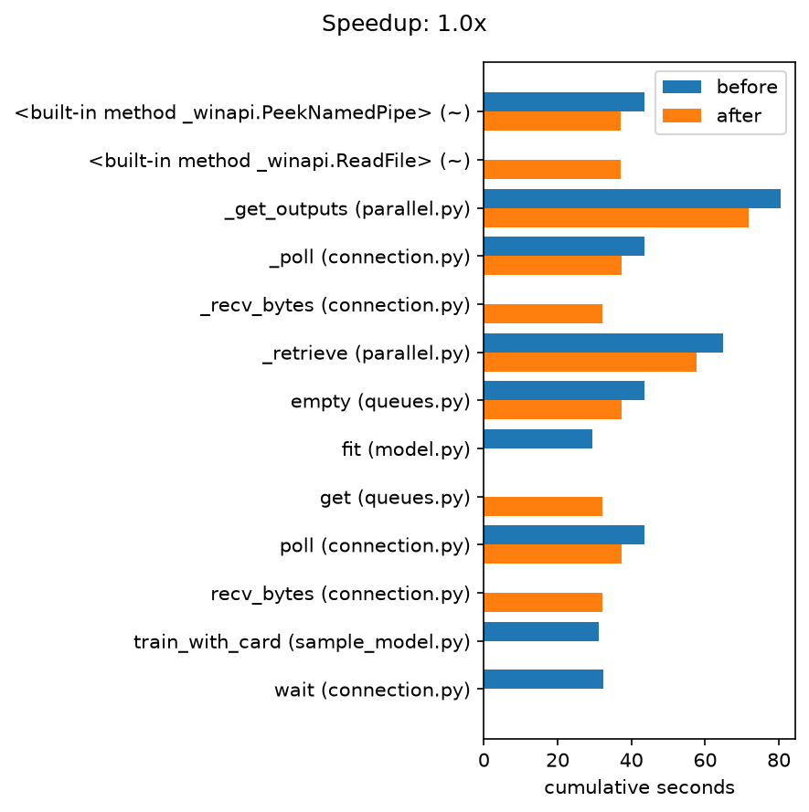

# Profiling preprocessing và training

Tài liệu này ghi lại kết quả của task **1.3.7**: đo hiệu năng hai đường chạy `preprocess-data` và
`sample-model`, tìm nút thắt, tối ưu những chỗ tối ưu được mà **không đổi hành vi**, và so sánh trước/sau.

## Cách chạy lại

Tên file kết quả: `preprocess-<label>.json` cho tiền xử lý, `train-<tên-spec>-<label>.json` cho training.

```bash
# đo (mỗi lệnh ghi một file JSON và một file .prof vào reports/profile/)
uv run invoke profile --target preprocess --label before --runs 3
uv run invoke profile --target train --label before --spec configs/model/logistic_regression.yaml --runs 3
uv run invoke profile --target train --label before --spec configs/model/champion.yaml --runs 2

# vẽ hình từ mọi cặp before/after có đủ hai phía
uv run invoke profile-figures

# xem chi tiết một file .prof
uv run snakeviz reports/profile/preprocess-before.prof
```

`reports/profile/*.json` được commit; `*.prof` bị gitignore vì dung lượng lớn.

## Môi trường đo

Python 3.12.15, Windows 11, pandas 3.0.6, numpy 2.5.3, scikit-learn 1.9.1, LightGBM 4.7.0, XGBoost 3.4.1.
Mỗi con số là trung vị của số lần chạy ghi trong cột `runs`; thời gian đo bằng `time.perf_counter()`.

Hai phía **before** và **after** được đo liền nhau trong cùng một phiên (chạy lại code cũ, đo, khôi phục
code mới, đo) để loại ảnh hưởng của tải máy. Số đo rời rạc ở những thời điểm khác nhau lệch tới 50%, nên
chỉ nên so sánh các cặp trong bảng dưới đây với nhau.

Giai đoạn (`stages`) được đo trong một lần chạy riêng, không phải phân rã của `wall_median`; vì vậy tổng
các giai đoạn không bằng đúng thời gian tổng.

## Trước khi tối ưu

| Đường chạy | Số lần | Thời gian (giây) |
|---|---|---|
| `preprocess` | 3 | 1.303 |
| `train` — logistic regression | 3 | 3.879 |
| `train` — champion | 2 | 23.053 |

Các giai đoạn của `preprocess` (giây):

| Giai đoạn | Trước |
|---|---|
| `read_csv` | 0.323 |
| `clean_bookings` | 0.184 |
| `time_split` | 0.066 |
| `write_splits` | 0.720 |
| `input_schema` | 0.014 |

Nút thắt rõ nhất là **vào/ra CSV**: đọc chiếm 25% và ghi chiếm 55% tổng thời gian `preprocess`. Trong
training, gần như toàn bộ thời gian nằm trong `fit`: với logistic regression là hai lần fit pipeline (một
lần để chọn ngưỡng, một lần trên toàn bộ train), với champion là ba mô hình tuần tự.

## Tối ưu đã áp dụng

**Đọc raw CSV bằng engine pyarrow của pandas** (`data.load_raw`). Đây là bước đọc chiếm phần lớn thời gian
đọc của `preprocess`.

Giữ nguyên hành vi bằng hai điểm:

- Sau khi đọc, cột `reservation_status_date` được ép về `str` (`astype(str)`). Engine pyarrow suy luận cột
  này là `date32` và pandas đổi thành `object` chứa `datetime.date`, trong khi engine mặc định trả về `str`.
  Ép lại đưa frame về đúng dtype và giá trị cũ.
- `read_split` **giữ nguyên engine mặc định**. Đã thử engine pyarrow cho nó nhưng loại bỏ: khi truyền
  `dtype=` engine pyarrow ép kiểu sau khi đọc nên làm mất số 0 ở đầu của mã dạng chuỗi (`"01"` → `"1"`) và
  ném `ValueError: cannot convert NA to integer` với cột số nguyên có ô trống. Toàn bộ lợi ích đo được đến
  từ `load_raw`, nên không đánh đổi rủi ro đó.

Bằng chứng tương đương (chạy trên dữ liệu thật):

- `load_raw` mới cho frame `.equals` với frame đọc bằng engine cũ, dtype từng cột trùng khớp.
- `clean_bookings` cho ra frame và bảng log giống hệt nhau.
- `read_split` (không đổi) đọc ba split cho frame `.equals` với bản snapshot trước thay đổi.
- Huấn luyện lại logistic regression: ngưỡng quyết định `0.18254583193161286` và test ROC-AUC
  `0.8585865507182504` trùng khớp với baseline.

## Sau khi tối ưu

| Đường chạy | Trước (giây) | Sau (giây) | Tăng tốc |
|---|---|---|---|
| `preprocess` | 1.303 | 1.046 | **1.25×** |
| `train` — logistic regression | 3.879 | 3.897 | 1.00× |
| `train` — champion | 23.053 | 22.923 | 1.01× |

Các giai đoạn của `preprocess` (giây):

| Giai đoạn | Trước | Sau |
|---|---|---|
| `read_csv` | 0.323 | **0.089** |
| `clean_bookings` | 0.184 | 0.173 |
| `time_split` | 0.066 | 0.065 |
| `write_splits` | 0.720 | 0.691 |
| `input_schema` | 0.014 | 0.014 |

Đọc CSV nhanh hơn khoảng 3.6 lần; phần còn lại gần như không đổi, nên ghi CSV (0.69 giây, 66% tổng thời
gian) trở thành nút thắt duy nhất. Hai đường chạy training không đổi trong sai số đo, đúng như dự đoán:
chúng bị chi phối bởi `fit`, không phải I/O.

### Hình









Lưu ý khi đọc hình của champion: ba mô hình được fit **tuần tự**, nhưng RandomForest tự chạy song song bằng
thread pool (`n_jobs=-1`, mặc định trong `model.py`). pstats cộng dồn thời gian của từng thread, nên tổng
thời gian tích luỹ theo hàm lớn hơn thời gian thực (field `share` trong JSON có thể lớn hơn 1). Vì vậy hình
champion dùng để so sánh hình dạng phân bố, không dùng để cộng tổng.

## Những tối ưu đã thử và loại bỏ

### 1. Ghi CSV bằng pyarrow

Đo trên ba tập split:

| Cách ghi | Thời gian |
|---|---|
| `DataFrame.to_csv` (hiện tại) | 0.758–0.943 giây |
| pyarrow, cột ngày format bằng `pyarrow.compute.strftime` | 1.136 giây (riêng `strftime` đã 0.954) |
| pyarrow, cột ngày format bằng pandas `.dt.strftime` | 0.169 giây |

Cách thứ ba nhanh gấp khoảng 5 lần nhưng **không giữ nguyên hành vi**: pyarrow ghi số thực `0.0` thành `0`,
nên khi đọc lại `children`, `agent`, `company`, `adr` có thể thành `int64` ở những split không có giá trị
khuyết; ngoài ra pyarrow đặt ngoặc kép cho chuỗi có khoảng trắng (`"Resort Hotel"`), làm file khác về byte.
Muốn dùng phải thay đổi hợp đồng kiểu dữ liệu của file split, nằm ngoài phạm vi "chỉ tối ưu, không đổi hành
vi" của task này, nên đã bỏ.

Đã thử thêm: chuyển cột phân loại sang `object` hoặc `category` trước khi `to_csv` (0.731–0.951 giây, không
nhanh hơn), nên giữ nguyên `to_csv`.

### 2. Bộ mã hoá tần suất tự viết thay `OneHotEncoder(min_frequency=30)`

Giả thuyết: sklearn đếm tần suất từng giá trị bằng Python nên chậm. Số đo thực tế (vi benchmark riêng, không
lấy từ file JSON):

| Cách | Fit (giây) | Transform (giây) | Số cột | Tương đương |
|---|---|---|---|---|
| `OneHotEncoder(min_frequency=30)` (hiện tại) | 0.649 | 0.184 | 177 | — |
| Truyền `categories=` tính sẵn bằng `value_counts` | lỗi | — | — | Không: `ValueError: Found unknown categories ['Undefined']` |
| `handle_unknown="ignore"` | 0.21 (tổng) | — | 339 | Không |
| Đưa cột về dtype `category` rồi fit | 0.789 (tổng) | — | 177 | Có (giá trị, tên cột, thứ tự category trùng) nhưng không nhanh hơn 0.832 |

Kết luận: không có biến thể nào vừa giữ nguyên đầu ra vừa nhanh hơn đáng kể. Profiler (có overhead) hiển thị
bước đếm tần suất khá lớn vì nó là hàng triệu lời gọi Python nhỏ; đo bằng đồng hồ thường thì bước này chỉ
chiếm khoảng 0.1–0.2 giây trong tổng 0.65 giây fit. Vì vậy không thay bộ mã hoá.

### 3. Đọc raw bằng `pyarrow.csv.read_csv` trực tiếp

Nhanh hơn nữa nhưng trả về dtype `object` cho cột chuỗi (pandas 3 dùng `str`) và xử lý giá trị khuyết khác
ở cột `country`, tức là đổi hành vi. Đã dùng `engine="pyarrow"` của pandas thay thế, vì pandas vẫn chuẩn
hoá dtype sau khi đọc.

## Khuyến nghị (chưa làm, cần bàn với nhóm)

- `write_splits` giờ là 66% thời gian `preprocess`; muốn cải thiện nữa phải chấp nhận đổi định dạng lưu
  (ví dụ Parquet) hoặc chuẩn hoá lại kiểu dữ liệu khi đọc.
- `train_with_card` fit hai lần (một lần để chọn ngưỡng, một lần trên toàn bộ train). Đây là thiết kế có chủ
  đích, không phải nút thắt kỹ thuật.
- RandomForest trong champion đã chạy đa luồng sẵn; muốn nhanh hơn nữa phải giảm số cây hoặc số đặc trưng,
  tức là đổi mô hình, nằm ngoài phạm vi task này.
